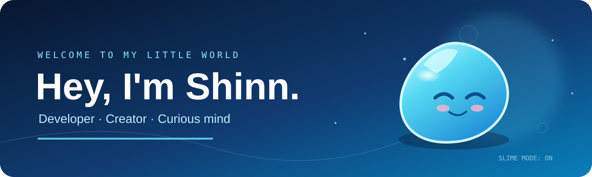

<!-- PROFILE BANNER -->

  

  

<h1 align="center">Hey, I'm Shinn!</h1>

  <strong>Developer · Creator · Curious mind</strong> 
  I turn ideas into useful things, one experiment at a time.

  

---

## ✦ A little about me

- I enjoy building **web applications**, useful tools, and creative side projects.
- I like clean interfaces as much as I like making things work.
- Currently exploring better ways to build, automate, and learn.

> **My loop:** Learn → Build → Break → Improve → Repeat.

## ✦ Tech I work with

  

## ✦ Things I've been building

| Project | What it is |
|:--|:--|
| [The Siblings](https://thesiblingsmartandcafe.vercel.app/) | A café and mart website |
| **Reaction Chamber** | An interactive chemistry learning project |
| **Student Automation** | Python tools for attendance and student ID workflows |
| [SAKRA](https://github.com/Shinnz-nouzen/SAKRA) | A clothing / creative brand project |

## ✦ GitHub activity

  
  

  

---

  
  Thanks for stopping by. Stay curious and keep creating. 
  💧 Slime mode: always on

